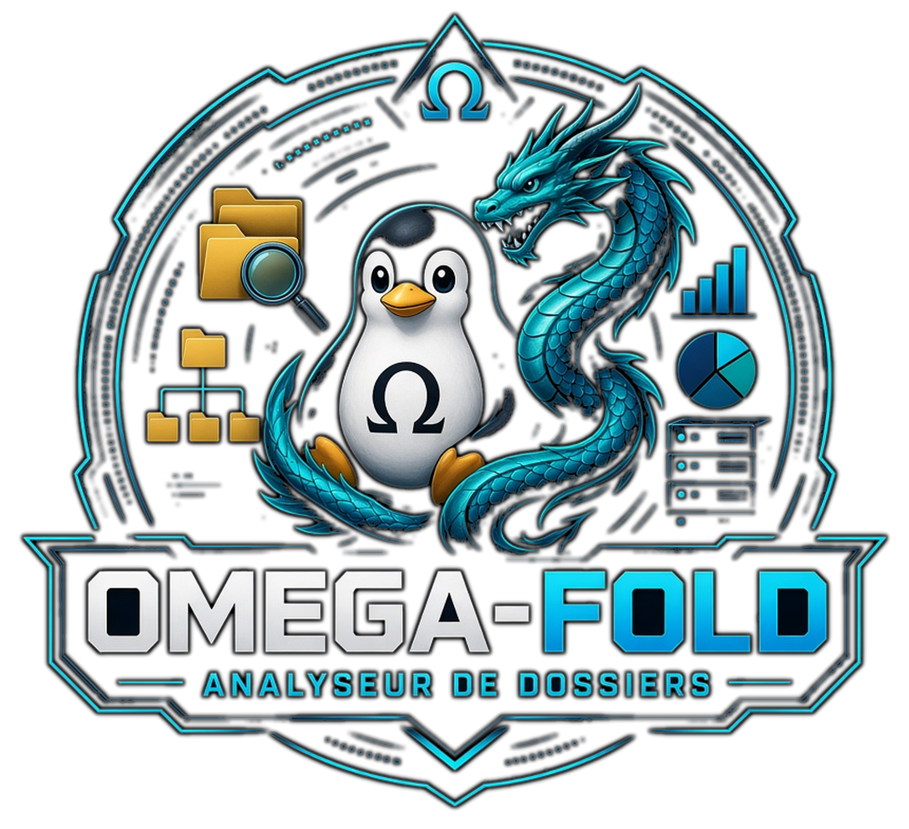

<!-- Copyright (c) 2026 kraynux - kraynux@proton.me - สัญญาอนุญาต MIT (ดูไฟล์ LICENSE) -->
<div align="center">
  
</div>

#  OMEGA-FOLD

**เครื่องมือวิเคราะห์โครงสร้างเว็บไซต์/ไดเรกทอรี (ภายในเครื่องและระยะไกล)**

> พัฒนาโดย [kraynux](https://github.com/kraynux) สำหรับ [Omega-Server](https://kraynux.snake-mackarel.ts.net)   

หน้าทางการ: [OMEGA-FOLD](https://kraynux.snake-mackarel.ts.net/omega-fold/) &nbsp; ภาพหน้าจอ: [SCREENSHOTS](https://kraynux.snake-mackarel.ts.net/omega-fold/screenshots/)  

[](../../../LICENSE)
[](https://www.python.org/)
[](https://www.linux.org/)
[](#3-การใช้งาน)

🌐 อินเทอร์เฟซและรายงานที่ส่งออกมีให้ใช้ **17 ภาษา** — ดู [ภาษาของอินเทอร์เฟซ](#ภาษาของอินเทอร์เฟซ)  
**ภาษา:**  
 [Français](../../../README.md) ·  [English](../en/README.md) ·  [Español](../es/README.md) ·  [Português (Brasil)](../pt-BR/README.md) ·  [Italiano](../it/README.md) ·  [Deutsch](../de/README.md) ·  [Nederlands](../nl/README.md) ·  [Polski](../pl/README.md) ·  [Русский](../ru/README.md) ·  [中文](../zh-CN/README.md) ·  [Tiếng Việt](../vi/README.md) ·  [ไทย](README.md) ·  [Bahasa Indonesia](../id/README.md) ·  [日本語](../ja/README.md) ·  [한국어](../ko/README.md) ·  [हिन्दी](../hi/README.md) ·  [العربية](../ar/README.md)

---

**Omega-fold** เป็นเครื่องมือแบบ TUI + CLI ที่วิเคราะห์โครงสร้างของไดเรกทอรีในเครื่องหรือเว็บไซต์ระยะไกล (การไล่เก็บผ่าน HTTP ที่มีขีดจำกัดความปลอดภัยกำกับ): ต้นไม้ไฟล์ครบถ้วน สถิติตามนามสกุล/กลุ่มไฟล์ แผนที่ลิงก์ (ภายใน/ภายนอก ทุกชนิด) และการตรวจหาลิงก์เสีย เป็นเครื่องมือหนึ่งในชุด `omega-` จัดโครงสร้างตาม Clean Architecture — รายละเอียดทางเทคนิคทั้งหมดดูที่ `docs/ARCHITECTURE.md`

<p align="center">
  
  
  
  
</p>

## 1. วิสัยทัศน์และขอบเขต

### สิ่งที่ Omega-fold ทำ

- สแกนไดเรกทอรีในเครื่อง (`os.walk` จริง) หรือไล่เก็บเว็บไซต์ระยะไกลแบบกว้างก่อน (BFS) ภายใต้ขีดจำกัดความปลอดภัยที่เข้มงวด
- สร้างต้นไม้ไฟล์ครบถ้วน (ไฟล์/ไดเรกทอรี ความลึก ขนาด) และจัดกลุ่มตามประเภท (`images`/`documents`/`code`/`data`/`archives`/`fonts`/`video`/`audio`/`text`/`other`) — ดู [§4](#4-กลุ่มไฟล์)
- ดึงลิงก์ทั้งหมด (`<a href>`, ``, `<script src>`, `<link href>`, `<form action>`) จากทุกหน้า/ไฟล์ HTML จัดประเภท (ภายในแบบสัมบูรณ์/สัมพัทธ์ ภายนอก จุดยึด `mailto:`/`tel:`/`javascript:`/`data:`) และตรวจว่ามีอยู่จริง — ดู [§5](#5-ลิงก์และการตรวจสอบ)
- คำนวณสถิติ: การกระจายตามนามสกุล/กลุ่ม ไฟล์ที่ใหญ่ที่สุด ไฟล์ที่มีลิงก์ขาออกมากที่สุด โดเมนภายนอกที่ถูกลิงก์มากที่สุด
- แสดงผลใน TUI (Textual) หรือ CLI ที่เขียนสคริปต์ได้ พร้อมการส่งออกสามแบบ (JSON, ข้อความ, HTML 5 ธีม)
- เก็บประวัติการสแกนถาวร (SQLite) ที่เปิดดูและเรียกซ้ำได้

### สิ่งที่ Omega-fold ไม่ทำ

- วิเคราะห์เนื้อหาหรือ SEO (ชื่อเรื่อง คำอธิบายเมตา ความหนาแน่นของคีย์เวิร์ด)
- ไล่เก็บโดยไม่มีขีดจำกัดความปลอดภัย — ความลึก จำนวนหน้า และช่วงเว้นระหว่างคำขอทำงานเสมอ
- เรนเดอร์ JavaScript ฝั่งไคลเอนต์ (ดึงหน้าตามที่เซิร์ฟเวอร์ส่งมา ไม่ได้รันในเบราว์เซอร์แบบไม่มีหน้าจอ)
- สแกนช่องโหว่เชิงรุก ฟัซซิง การเดารหัสแบบ brute force
- แดชบอร์ดเว็บ

## 2. การติดตั้ง

### ข้อกำหนดเบื้องต้น

- Python 3.10+
- การเชื่อมต่ออินเทอร์เน็ต สำหรับติดตั้งส่วนที่ต้องพึ่งพา
- สำหรับ TUI: ฟอนต์ [Nerd Font](https://www.nerdfonts.com/) ที่ติดตั้งในเทอร์มินัล สำหรับไอคอนในส่วนหัว — หากไม่มี อักขระนี้จะแสดงเป็นกล่องว่าง (ข้อจำกัดเดียวกับอีโมจิ แต่ผู้ใช้เทอร์มินัลมีฟอนต์นี้กันแพร่หลายกว่ามาก) การไม่มีฟอนต์ไม่กระทบการทำงาน เป็นเรื่องความสวยงามล้วน ๆ

### การติดตั้ง

```bash
[ -d omega-fold ] && echo "ℹ️ แตกไฟล์ไว้ที่นี่แล้ว ข้ามขั้นตอนนี้" || tar -xzf omega-fold.tar.gz
cd omega-fold/
chmod +x install.sh
./install.sh
```

`install.sh`:

1. สร้างสภาพแวดล้อมเสมือน `.venv` หากยังไม่มี
2. ติดตั้งส่วนที่ต้องพึ่งพา (`vendor/omega-lib/` แล้วตามด้วย `pip install -e .`; `pyproject.toml` ยังคงเป็นแหล่งข้อมูลหลักเพียงแหล่งเดียว)
3. ทำให้ `omega-fold.sh` และ `install.sh` เรียกใช้งานได้
4. เพิ่มชื่อแทน `fold` ลงใน `~/.bashrc` และ `~/.zshrc` (ไม่เพิ่มซ้ำหากมีอยู่แล้ว)

### ส่วนที่ต้องพึ่งพา

ประกาศไว้ใน `pyproject.toml` (ไม่มี `requirements.txt`):
- `omega-lib`: ไลบรารีที่ใช้ร่วมกันของชุดเครื่องมือ (ธีมการส่งออก, `ConfidenceLevel`) — รวมมาใน `vendor/omega-lib/`
- `httpx`: ตรวจลิงก์ภายนอกแบบซิงโครนัส (`LinkChecker`)
- `aiohttp`: ไล่เก็บ HTTP แบบอะซิงโครนัส (`DistantCrawler`)
- `beautifulsoup4` + `lxml`: ดึงลิงก์ HTML
- `jinja2`: เทมเพลตสำหรับการส่งออก HTML
- ส่วนที่ต้องพึ่งพาสำหรับการพัฒนา (`pip install -e ".[dev]"`): `pytest`, `pytest-asyncio`, `pytest-cov`, `pytest-httpserver`, `ruff`, `mypy`, `import-linter`

## 3. การใช้งาน

### โหมดโต้ตอบ (TUI)

แนะนำสำหรับการใช้งานประจำวัน — เรียกโดยไม่ใส่อาร์กิวเมนต์:

```bash
./omega-fold.sh
```
หากสร้างชื่อแทนไว้แล้ว เพียงพิมพ์ `fold` ในเทอร์มินัล:
```bash
fold
```

ลำดับการใช้งาน: หน้าจอเริ่มต้น (ปิดด้วยการกดปุ่มหรือคลิก) → เมนูหลัก (สแกน / ประวัติ / การตั้งค่า / ช่วยเหลือ) → กรอกเป้าหมาย ประเภท (ในเครื่อง/ระยะไกล) โหมด (สถิต/พลวัต) และขีดจำกัดความปลอดภัยของการไล่เก็บระยะไกล ทุกช่องมีป้ายกำกับชัดเจน → การสแกน (แถบความคืบหน้าแบบไม่ระบุ บันทึกการทำงานสด ปุ่มยกเลิกได้ทุกเมื่อ) → รายละเอียดการสแกน (การกระจายตามกลุ่มและนามสกุล ต้นไม้ไฟล์ ลิงก์เสีย การส่งออก) → ประวัติ (ดูรายละเอียด **ส่งออกได้ทันที** โดยไม่ต้องผ่านหน้ารายละเอียด เรียกซ้ำ) และการตั้งค่าจากเมนูหลัก การปรับให้เข้ากับเทอร์มินัล (สี ขนาด การลดทอนโครงสร้าง) เป็นไปโดยอัตโนมัติ

#### แป้นลัด

| แป้น | การทำงาน |
|---|---|
| `↑` / `↓` | เลื่อนไปมาระหว่างรายการบนหน้าจอ |
| `Tab` / `Shift+Tab` | เลื่อนไปมาระหว่างช่องของแบบฟอร์ม |
| `Esc` | กลับไปหน้าจอก่อนหน้า (ยืนยันการออกเมื่ออยู่ที่หน้าแรก) |
| `t` | ธีมถัดไป (ใช้ทันที ไม่ต้องยืนยัน) |
| `r` | รีเฟรชการตรวจจับเทอร์มินัล |
| `a` | แสดงความช่วยเหลือ |
| `q` | ออก (ต้องยืนยัน) |

### ภาษาของอินเทอร์เฟซ

อินเทอร์เฟซมีให้ใช้ 17 ภาษา: ฝรั่งเศส อังกฤษ สเปน โปรตุเกส (บราซิล) อิตาลี เยอรมัน ดัตช์ โปแลนด์ รัสเซีย จีนตัวย่อ เวียดนาม ไทย อินโดนีเซีย ญี่ปุ่น เกาหลี ฮินดี และอาหรับ เลือกได้ในการตั้งค่า (“Langue / Language”) และมีผลหลังจากรีสตาร์ตอินเทอร์เฟซ ตัวแปร `OMEGA_FOLD_LANG` (เช่น `OMEGA_FOLD_LANG=th ./omega-fold.sh`) ใช้บังคับภาษาสำหรับหนึ่งเซสชัน เมื่อเปิดจาก omega-suite แล้ว omega-fold จะใช้ภาษาของชุดเครื่องมือ บนคอนโซลข้อความของ Linux (TTY) ภาษาที่ไม่ได้ใช้อักษรละตินจะแสดงเป็นภาษาอังกฤษตลอดเซสชันนั้น บรรทัดคำสั่งยังคงเป็นภาษาฝรั่งเศส

### ติดต่อและสนับสนุน

ความช่วยเหลือ (ปุ่ม `a`) มีหน้าจอ **ติดต่อและสนับสนุน**: *เลี้ยงกาแฟ* (หน้า PayPal ของผู้พัฒนา), *ติดต่อฝ่ายสนับสนุน* (ที่อยู่อีเมลและแบบฟอร์มติดต่อของเว็บไซต์ แสดงเป็นข้อความธรรมดา), *ลงทะเบียนเป็นผู้ใช้ (นิรนาม)* และ *ตรวจสอบการอัปเดต* การลงทะเบียนเป็นไปโดยสมัครใจ ปิดไว้เป็นค่าเริ่มต้น และส่งเพียงครั้งเดียว ใช้เพื่อนับจำนวนผู้ใช้เท่านั้น และหากต้องการ นับทวีปหรือประเทศของผู้ใช้ (รายการปิด ไม่มีข้อความอิสระ) ระบบจะส่งคีย์ที่สุ่มขึ้น ชื่อซอฟต์แวร์ (`omega-fold`) และเวอร์ชัน ไม่ส่งชื่อ ชื่อเครื่อง การตั้งค่า เป้าหมาย หรือผลลัพธ์ใด ๆ ที่อยู่ IP จะไม่ถูกบันทึกในการลงทะเบียน แต่เช่นเดียวกับการเข้าชมทุกครั้ง จะผ่านการตรวจสอบความปลอดภัยและบันทึกของเซิร์ฟเวอร์ที่รับข้อมูล ถอนการลงทะเบียนได้ทุกเมื่อจากหน้าจอเดียวกัน (*ไม่ต้องลงทะเบียนฉันอีก*) การตรวจสอบการอัปเดตเพียงอ่านรายการเวอร์ชันที่เผยแพร่บนเว็บไซต์ และไม่ทำโดยไม่มีการคลิก

### โหมดสคริปต์ (CLI)

คำสั่งย่อยใดก็ตามจะเปิดโหมด CLI:

```bash
# สแกนในเครื่อง (ต้นไม้ไฟล์ + ลิงก์ภายใน)
./omega-fold.sh scan /var/www/mysite --type local

# สแกนในเครื่องแบบพลวัต (ตรวจลิงก์ภายนอกผ่าน HTTP ด้วย)
./omega-fold.sh scan /var/www/mysite --type local --mode dynamic

# สแกนระยะไกล (ไล่เก็บแบบ BFS จาก URL เริ่มต้น)
./omega-fold.sh scan https://example.org --type distant --mode dynamic \
    --max-depth 3 --max-pages 200 --delay 200 --respect-robots

# ประวัติ (กรองตามเป้าหมายได้)
./omega-fold.sh history --target /var/www/mysite --limit 20

# รายละเอียดการสแกน (ข้อความ, JSON หรือ HTML) — เลือกธีมการส่งออกได้ 5 แบบ
./omega-fold.sh show <scan_id> --format html --theme omega-base --output report.html
```

ตัวเลือกของ `scan`:

| ตัวเลือก | ค่าเริ่มต้น | ผล |
|---|---|---|
| `--type` | *(จำเป็น)* | `local` หรือ `distant` (ระยะไกล) |
| `--mode` | `static` | `static` (ไม่ตรวจลิงก์ภายนอก) หรือ `dynamic` (ตรวจผ่าน HTTP) |
| `--max-depth` | `5` | ความลึกสูงสุดที่ติดตาม (สแกนระยะไกล) |
| `--max-pages` | `1000` | จำนวนหน้าสูงสุดที่ไล่เก็บ (สแกนระยะไกล) |
| `--delay` | `100` | ช่วงเว้น (มิลลิวินาที) ระหว่างสองคำขอ (สแกนระยะไกล) |
| `--user-agent` | `omega-fold/0.1` | ส่วนหัว `User-Agent` ที่ส่ง (สแกนระยะไกล) |
| `--respect-robots` | ปิด | ปฏิบัติตาม `robots.txt` (สแกนระยะไกล) |

สำหรับการสแกนระยะไกล เป้าหมายที่ไม่มีโปรโตคอล (`example.org`) จะถูกเติมเป็น `https://example.org` โดยอัตโนมัติ — ไม่ต้องระบุ เว้นแต่ต้องการบังคับใช้ `http://` อย่างชัดแจ้ง

หากเว็บไซต์มีจำนวนหน้ามากกว่า `--max-pages` (ค่าเริ่มต้น 1000) การสแกนจะหยุดที่ขีดจำกัดแต่แจ้งอย่างชัดเจน: `scan.status` จะเป็น `completed_truncated` แทน `completed` พร้อมคำเตือนที่มองเห็นได้ในสรุปของ CLI หน้าจอรายละเอียดของ TUI และการส่งออก HTML — จำนวนไฟล์ที่รายงานจึงไม่ใช่ขนาดจริงของเว็บไซต์ ให้รันใหม่ด้วย `--max-pages` ที่สูงขึ้นเพื่อให้ครอบคลุมทั้งหมด

หาก `install.sh` สร้างชื่อแทนไว้ `fold scan ...` จะใช้ได้จากทุกที่ในเทอร์มินัล โดยไม่ต้องมีคำนำหน้า `./omega-fold.sh`

## 4. กลุ่มไฟล์

แต่ละไฟล์ถูกจัดเข้ากลุ่มตามนามสกุล (รายการแรกที่ตรงกันเป็นผู้ชนะ) — รายละเอียดทั้งหมดและตารางรายนามสกุล: `docs/FAMILIES.md`

| กลุ่ม | ตัวอย่างนามสกุล |
|---|---|
| `images` | `.jpg`, `.png`, `.svg`, `.webp`, `.ico`... |
| `documents` | `.pdf`, `.doc`, `.xlsx`, `.odt`... |
| `code` | `.html`, `.php`, `.js`, `.ts`, `.py`, `.css`... |
| `data` | `.json`, `.xml`, `.yaml`, `.csv`, `.sql`... |
| `archives` | `.zip`, `.tar`, `.gz`, `.7z`... |
| `fonts` | `.ttf`, `.otf`, `.woff`, `.woff2`... |
| `video` | `.mp4`, `.webm`, `.mkv`... |
| `audio` | `.mp3`, `.wav`, `.flac`... |
| `text` | `.txt`, `.md`, `.rst`, `.log` |
| `other` | ที่เหลือทั้งหมด |

## 5. ลิงก์และการตรวจสอบ

### การจัดประเภท

ลิงก์แต่ละรายการที่พบ (`href`/`src`/`action`) จะถูกจัดประเภทตามลำดับความสำคัญนี้:

| ประเภท | ระบุได้เมื่อ | ตัวอย่าง |
|---|---|---|
| `empty` | สตริงว่าง | `href=""` |
| `mailto` / `tel` / `javascript` / `data` | โปรโตคอลพิเศษ | `mailto:x@y.z` |
| `anchor` | ขึ้นต้นด้วย `#` โดยตรง (จุดยึดล้วน) | `#section` |
| `external` | `http://`, `https://` หรือ `//` (สัมพัทธ์กับโปรโตคอล) | `https://example.org` |
| `absolute` | ขึ้นต้นด้วย `/` | `/img/logo.png` |
| `relative` | ที่เหลือทั้งหมด | `img/logo.png`, `../page.html` |

`absolute` และ `relative` คือสองรูปแบบของลิงก์ **ภายใน** — ลิงก์ `page.html#section` ยังคงเป็น `relative` (ส่วนท้ายไม่ได้ทำให้มันเป็นแค่จุดยึด มันพาไปยังทรัพยากรอื่นจริง ๆ)

### การตรวจสอบ

- **ลิงก์ภายใน**: ตรวจกับชุดเส้นทางที่พบจริงระหว่างการสแกนเสมอ (ไม่มีคำขอเครือข่าย) — `absolute` แปลงจากรากของการสแกน `relative` ที่มีตัวคั่นแปลงจากไดเรกทอรีของไฟล์ต้นทาง `relative` ที่ไม่มีตัวคั่น (ชื่อไฟล์อย่างเดียว) ค้นหาทั่วทั้งต้นไม้ สำหรับการสแกนระยะไกล การตรวจจะทำในรอบที่สองหลังไล่เก็บเสร็จ โดยเทียบกับชุดหน้าที่เข้าชมสำเร็จจริง — หน้าที่อยู่นอกขีดจำกัดความปลอดภัยหรือถูก `robots.txt` บล็อกจะคงเป็น `unchecked` ไม่ถูกเดาว่าเป็น `broken`
- **ลิงก์ภายนอก**: ตรวจด้วยคำขอ HTTP (HEAD แล้วตามด้วย GET หาก HEAD ล้มเหลว) เฉพาะในโหมด `dynamic` — ในโหมด `static` จะคงเป็น `unchecked`

## 6. ขีดจำกัดความปลอดภัยของการไล่เก็บระยะไกล

ทำงานเสมอ ปิดไม่ได้ — ปรับได้เฉพาะค่าเกณฑ์:

- **ความลึก** (`--max-depth`): จำกัดเฉพาะการเพิ่มหน้าใหม่เข้าคิวไล่เก็บ ลิงก์ที่พบบนหน้าที่เข้าชมแล้วจะปรากฏในผลลัพธ์เสมอ แม้หน้าปลายทางจะไม่ถูกติดตาม
- **จำนวนหน้า** (`--max-pages`): จำกัดจำนวนหน้าที่เข้าชมทั้งหมดในทุกระดับความลึก
- **ช่วงเว้น** (`--delay`): การพักระหว่างคำขอ HTTP สองคำขอติดกัน
- **โดเมนเดียวกัน**: ติดตามเฉพาะลิงก์ภายในที่ไปยัง `netloc` เดียวกับ URL เริ่มต้น — ตรวจทั้งเส้นทางของลิงก์และ URL **ที่โหลดจริงหลังการเปลี่ยนเส้นทาง**: ลิงก์ถาวรที่เส้นทางดูเหมือนโฟลเดอร์ภายใน (`/go/xyz`, `/public/name/`) แต่จริง ๆ แล้วเปลี่ยนเส้นทางไปยังโดเมนภายนอก จะไม่ถูกนับเป็นหน้าของเว็บไซต์ที่สแกน (เนื้อหาของมันไม่ใช่ของคุณ)
- **`robots.txt`** (`--respect-robots`): เสริมขีดจำกัดความปลอดภัยแทนที่จะลดทอน — หน้าที่ถูกห้ามจะไม่ถูกเข้าชม ลิงก์ขาออกของหน้านั้นคงเป็น `unchecked`

## 7. สถาปัตยกรรม

Omega-fold จัดโครงสร้างตาม **Clean Architecture** (domain / application / infrastructure / interfaces / ports / core / app / plugins / shared) สอดคล้องกับแม่แบบของชุด `omega-` (ดู `omega-scan`/`omega-check`/`omega-deep`) และตรวจสอบด้วย `import-linter` ทุกครั้งที่แก้ไข รายละเอียดทั้งหมดอยู่ใน **`docs/ARCHITECTURE.md`**

ภาพรวมแบบสั้นมาก:

```text
src/omega_fold/
├── domain/          ตรรกะทางธุรกิจล้วน: การสแกน ต้นไม้ไฟล์ (tree) ลิงก์ สถิติ รายงาน
├── application/     กรณีการใช้งาน (commands/queries) — run_scan (ในเครื่อง/ระยะไกล), export_scan_report...
├── ports/           สัญญาที่แอปพลิเคชันคาดหวัง (local_fs_reader, distant_crawler,
│                    html_link_extractor, link_checker, scan_repository, report_exporter...)
├── infrastructure/  การทำงานจริง (os.walk, aiohttp, httpx, BeautifulSoup, SQLite,
│                    ตัวส่งออก Jinja2 — Textual ไม่ได้อยู่ที่นี่)
├── interfaces/      tui/ (Textual) และ cli/ (เขียนสคริปต์ได้) ความสามารถเท่ากันอย่างเคร่งครัด
├── app/             การประกอบ (DependencyContainer, bootstrap, วงจรชีวิต)
├── core/, shared/   คำศัพท์ร่วม เครื่องมือที่ไม่เกี่ยวกับธุรกิจ
└── plugins/         วางโครงสร้างไว้แล้ว ยังว่าง (ยังไม่มีแนวทางขยายที่ยืนยันแล้ว)
```

กฎการออกแบบ:
- `domain/tree/service.py`: รวมรายการไฟล์แบบแบนที่รู้อยู่แล้วให้เป็นต้นไม้ ไม่ทำ I/O เลย — การไล่จริง (`os.walk`) อยู่ใน `infrastructure/filesystem/`
- `domain/scans/policies.py`: ขีดจำกัดความปลอดภัยของการไล่เก็บ (ความลึก/หน้า/โดเมน) ตรรกะล้วนที่ทดสอบได้โดยไม่ต้องใช้เครือข่าย
- `infrastructure/filesystem/` และ `infrastructure/network/`: ทำ I/O (ดิสก์, HTTP) ไม่ตัดสินใดๆ
- `infrastructure/exporters/`: อ่านผลการสแกนที่ประกอบไว้แล้ว ไม่คำนวณสถิติใหม่
- `infrastructure/storage/sqlite/`: เก็บเฉพาะข้อมูลต้นทาง (`scans`/`files`/`links`) — ต้นไม้ไฟล์และสถิติถูกคำนวณใหม่ตอนอ่านด้วยฟังก์ชันล้วนชุดเดียวกับการสแกนครั้งแรก (ดู `DECISIONS_ARCHITECTURE.md`, D-011) ไม่เก็บซ้ำในฐานข้อมูล

## 8. การส่งออก

รายงานข้อความและ HTML เขียนด้วยภาษาที่เลือกในการตั้งค่า (“ภาษาของการส่งออก” ค่าเริ่มต้นคือภาษาของอินเทอร์เฟซ) ส่วน JSON ยังคงเป็นข้อมูลและไม่ถูกแปล รายงานถูกสร้างใน `var/exports/` เป็นค่าเริ่มต้น (เส้นทางขณะทำงานยึดกับโฟลเดอร์โปรเจกต์ ใช้ `$OMEGA_FOLD_VAR_DIR` เพื่อเปลี่ยน) หรือที่เส้นทางที่ระบุ (`--output`)

### JSON แหล่งข้อมูลหลัก

โครงสร้างทั้งหมดของผลลัพธ์ (`Scan` + ต้นไม้ไฟล์ + ลิงก์ + สถิติ) แปลงเป็น JSON ได้อย่างเคร่งครัด

### ข้อความ รายงานกะทัดรัดสำหรับอ่าน

สรุป การกระจายตามกลุ่ม ต้นไม้ ASCII (จำกัดความลึก 6 ระดับ — รายงานข้อความไม่ได้มีไว้แสดงต้นไม้หลายพันไฟล์) รายการลิงก์เสีย

### HTML รายงานเว็บแบบสมบูรณ์ในตัว

เลือกได้ 5 ธีม (`--theme`) ขนาดรวมของเว็บไซต์ถูกเน้นเป็นอันดับแรก (เป็นเป้าหมายหลักของรายงานการสแกน) และแสดงในรูปแบบอ่านง่าย (KB/MB/GB...) ในทุกที่ — CLI, TUI, การส่งออก — แทนจำนวนไบต์ดิบ เลย์เอาต์เฉพาะ: คอนเทนเนอร์ ตารางสถิติ ฮิสโทแกรม SVG ของการกระจายตามกลุ่ม (วาดด้วยมือ ไม่มีไลบรารีกราฟหนัก ๆ — เทคนิคเดียวกับแผนภาพสถาปัตยกรรมของ `omega-deep`) ตารางนามสกุล/ไฟล์ที่ใหญ่ที่สุด โดเมนภายนอกที่ถูกลิงก์แสดง 20 อันดับแรกทันที ที่เหลืออยู่ในแผงที่พับได้ (มีประโยชน์กับเว็บไซต์ที่มีการเปลี่ยนเส้นทางออกนอกหลายร้อยรายการ) รายการลิงก์เสียถูกพับไว้เป็นค่าเริ่มต้น

ต้นไม้ไฟล์แสดงเป็น HTML ดั้งเดิมแบบ **หลายระดับ**: หนึ่ง `<details>` ต่อหนึ่งไดเรกทอรี เปิดเฉพาะรากเป็นค่าเริ่มต้น โฟลเดอร์ย่อยแต่ละอันขยายได้อิสระเมื่อคลิก (ได้แรงบันดาลใจจากสคริปต์สร้างดัชนีของผู้ใช้) — เบราว์เซอร์จัดวางเฉพาะเนื้อหาที่เปิดอยู่ จึงยังใช้งานได้ดีแม้กับเว็บไซต์ที่มีไฟล์หลายหมื่นไฟล์ โดยไม่ต้องใช้ JavaScript

## 9. ประวัติ

ทุกการสแกนถูกบันทึกไว้ (SQLite, `var/db/omega-fold.db`) เปิดดูประวัติตามเป้าหมายได้ (`omega-fold history --target ...`) ดูรายละเอียดการสแกนที่ผ่านมา (`omega-fold show <scan_id>`) หรือใช้เมนูประวัติของ TUI (รวมการเรียกซ้ำ)

## 10. ความเข้ากันได้กับเทอร์มินัล

TUI (Textual) ตรวจจับความสามารถของเทอร์มินัล (อีมูเลเตอร์ ขนาด) โดยอัตโนมัติ และปรับสไตล์ชีตเชิงโครงสร้างให้เหมาะสม (`complete`/`standard`/`reduced`/`mono`) โดยไม่ต้องตั้งค่าเอง โหมด CLI เป็นข้อความธรรมดาเสมอ ไม่ขึ้นกับเทอร์มินัล เป็นนโยบายที่ใช้ร่วมกันทั้งชุด `omega-` (`omega-lib`, `terminal/policies.py`)

### โปรไฟล์ตามอีมูเลเตอร์ที่ตรวจพบ

| อีมูเลเตอร์ | โปรไฟล์เริ่มต้น |
|---|---|
| Ghostty, Alacritty, WezTerm, Kitty | `complete` |
| Konsole, GNOME Terminal, Terminator, Xfce4 Terminal | `standard` |
| xterm, urxvt, SSH รุ่นใหม่ | `reduced` |
| TTY ของ Linux, SSH รุ่นเก่า | `mono` |
| อีมูเลเตอร์ที่ไม่รู้จัก | `reduced` (ค่าสำรองเริ่มต้น) |

### โปรไฟล์ตามขนาดเทอร์มินัล

| ขนาดขั้นต่ำ (คอลัมน์ × บรรทัด) | เพดานโปรไฟล์ |
|---|---|
| 120 × 32 | `complete` |
| 100 × 28 | `standard` |
| 80 × 24 | `reduced` |
| ต่ำกว่านั้น | `mono` |

โปรไฟล์สุดท้ายคือ **โปรไฟล์ที่เข้มงวดกว่าในสองแบบ** (อีมูเลเตอร์และขนาด) — รีเฟรชสดได้ด้วยแป้น `r`

## 11. การทดสอบ

```bash
source .venv/bin/activate
lint-imports        # ตรวจ Dependency Rule (6 สัญญา)
pytest -q           # 186 การทดสอบ
ruff check src tests
mypy -p omega_fold
```

โครงสร้าง: `tests/unit/` (โดเมนและโครงสร้างพื้นฐานโดยไม่มี I/O จริง — ตัวส่งออก กราฟ SVG มาร์กอัปของหน้าจอเริ่มต้น TUI), `tests/integration/` (ระบบไฟล์จริงผ่าน `tmp_path` เซิร์ฟเวอร์ HTTP จำลอง `pytest-httpserver` ฐานข้อมูล SQLite จริง CLI ตั้งแต่ต้นจนจบ), `tests/tui/` (การนำทางผ่าน `Pilot` เชิงโครงสร้าง — ไม่อ้างว่าตรวจสอบภาพเอง ดู `docs/ARCHITECTURE.md` §อินเทอร์เฟซ TUI)

## 12. นอกขอบเขต

- การวิเคราะห์เนื้อหา/SEO
- การเรนเดอร์ JavaScript ฝั่งไคลเอนต์
- การไล่เก็บโดยไม่มีขีดจำกัดความปลอดภัย
- การสแกนช่องโหว่เชิงรุก ฟัซซิง brute force
- แดชบอร์ดเว็บ

---

> Omega-fold — ทำแผนที่โครงสร้าง ตรวจลิงก์ของมัน และไม่เดาสิ่งที่ไม่ได้เข้าชม
